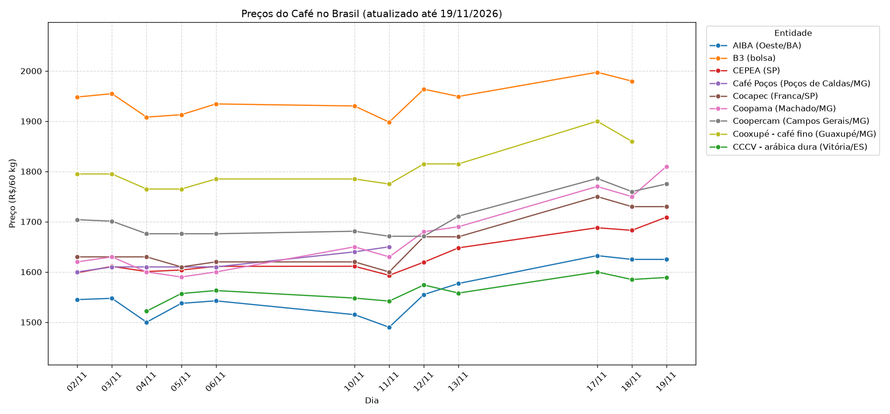
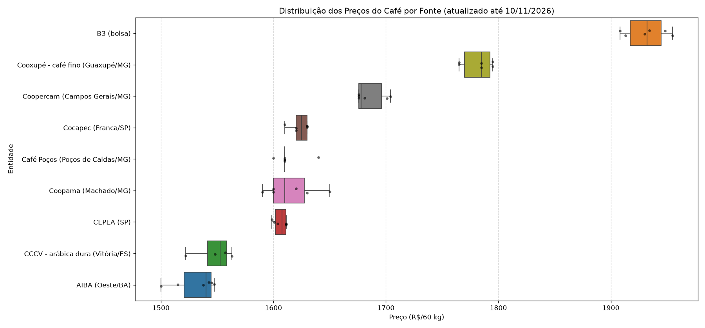

# ☕ Cotação do Café

Coleta **automática e diária** de cotações do café em várias fontes públicas, formando um histórico de preços em um arquivo CSV.

Projeto desenvolvido para a disciplina de **Ciência de Dados** (IFSULDEMINAS – Campus Machado), a partir de um notebook de *web scraping* criado no Google Colab e depois automatizado com o **GitHub Actions**.

## 📌 Como funciona

1. De **segunda a sexta, às 18h17 (horário de Brasília)**, o GitHub Actions executa o script `coletar_cotacao.py`.
2. O script acessa as páginas das fontes, extrai o preço de cada uma e monta uma linha com a data do dia.
3. A linha é acrescentada ao arquivo [`precos_cafe.csv`](precos_cafe.csv).
4. O script também gera dois gráficos a partir do histórico (pasta [`graficos/`](graficos/)).
5. Se algum arquivo mudou, o próprio workflow salva o resultado no repositório com um commit chamado `Cotação de dd/mm/aaaa`.

Se uma fonte estiver fora do ar ou mudar o layout, só a coluna dela fica vazia naquele dia. As demais continuam sendo coletadas. Se o script rodar mais de uma vez no mesmo dia, a linha do dia é substituída, sem duplicar.

## 🗂️ Estrutura do repositório

```
Cotacao_Cafe/
├── .github/workflows/cotacao.yml   # agendamento e execução diária
├── coletar_cotacao.py              # script de coleta (web scraping)
├── precos_cafe.csv                 # histórico de preços (atualizado pelo robô)
├── graficos/                       # gráficos gerados a cada coleta
│   ├── evolucao_precos.png
│   └── distribuicao_precos.png
├── requirements.txt                # dependências Python
└── README.md
```

## 📊 Formato dos dados

O arquivo `precos_cafe.csv` tem **uma linha por dia** e **uma coluna por fonte**:

| Coluna | Descrição |
|---|---|
| `data` | Data da coleta, no formato `dd/mm/aaaa` |
| `b3` | Preço calculado a partir do ICF (bolsa) e do dólar comercial, obtidos pelo Hub do Café da Cooxupé |
| `coopama` | Cooperativa Coopama – café duro tipo 6 |
| `cepea` | Indicador CEPEA/ESALQ |
| `coopercam` | Coopercam – duro limpo |
| `ccmg` | Centro do Comércio de Café de Minas Gerais *(fonte desativada, coluna vazia — o site bloqueia acessos automatizados)* |
| `cooxupe` | Cooxupé – café fino |
| `cafe-pocos` | Praça de Poços de Caldas (Notícias Agrícolas) – tipo 6 duro |
| `cocapec` | Cocapec – café 6 duro |
| `aiba` | AIBA |
| `cccv` | Centro do Comércio de Café de Vitória – **arábica, bebida "dura"** |
| `cccv-conilon` | CCCV – conilon (valores históricos de 02/11 a 04/11/2026; deixou de ser coletado e **não aparece nos gráficos**) |

Valores em reais (R$) por saca de 60 kg. Células vazias indicam que a fonte não retornou preço naquele dia.

Exemplo (a coluna `cccv` só passou a ser arábica a partir da migração):

```csv
data,b3,coopama,cepea,coopercam,ccmg,cooxupe,cafe-pocos,cocapec,aiba,cccv,cccv-conilon
02/11/2026,1948.1,1620.0,1598.37,1704.0,,1795.0,1600.0,1630.0,1545.0,,923.0
```

> Alguns sites publicam o fechamento do dia anterior, ou do último dia útil. Por isso, o valor de uma coluna pode corresponder a uma data diferente da coluna `data`.

## 📈 Gráficos

Atualizados automaticamente a cada coleta:

**Evolução dos preços**



**Distribuição dos preços por fonte (boxplot)**



## 📥 Usando os dados

O arquivo pode ser lido direto do GitHub, sem baixar nada:

```python
import pandas as pd

url = "https://raw.githubusercontent.com/AryaneMachado/Cotacao_Cafe/main/precos_cafe.csv"
df = pd.read_csv(url)
df["data"] = pd.to_datetime(df["data"], format="%d/%m/%Y")
print(df.tail())
```

## 🚀 Executando localmente

Requisitos: Python 3.12 (ou próximo) e o Git.

```bash
git clone https://github.com/AryaneMachado/Cotacao_Cafe.git
cd Cotacao_Cafe
pip install -r requirements.txt
python coletar_cotacao.py
```

Isso acrescenta (ou atualiza) a linha de hoje no `precos_cafe.csv`.

Para rodar a coleta manualmente no GitHub, abra a aba **Actions**, escolha **Coletar cotação do café** e clique em **Run workflow**.

## 🛠️ Tecnologias

- Python
- `requests` e `BeautifulSoup` (coleta e leitura das páginas)
- `pandas` (manipulação do CSV)
- `matplotlib` e `seaborn` (gráficos)
- `pytz` (fuso horário de Brasília)
- GitHub Actions (agendamento e automação)

## ⚠️ Observações

- Os dados vêm de páginas públicas de terceiros, coletadas por *web scraping*. Se um site mudar o layout, o coletor daquela fonte precisa ser ajustado.
- Este projeto tem finalidade acadêmica. Os valores coletados não substituem a consulta direta às fontes oficiais.

## 👩‍💻 Autora

**Aryane Cassimiro Machado**
[LinkedIn](https://www.linkedin.com/in/aryane-cassimiro-machado-6a79451b8/) · [GitHub](https://github.com/AryaneMachado)
